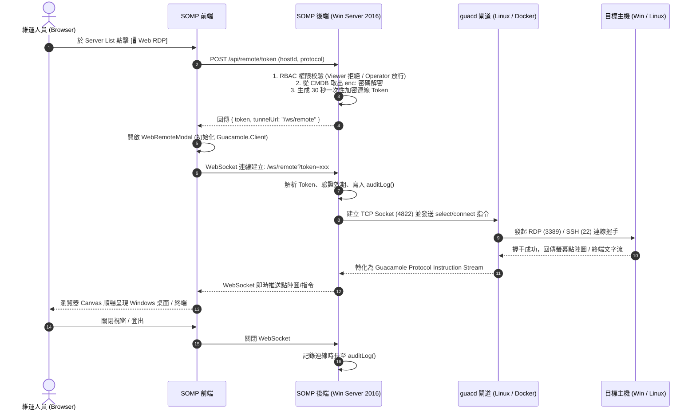

# SOMP Vanguard - 基於 Apache Guacamole 的純瀏覽器 Web-RDP & Web-SSH 整合架構規格書

> **文件版本**：1.0.0 Enterprise  
> **建立日期**：2026-09-14  
> **適用環境**：Windows Server 2016+ / SOMP Vanguard (sys-op-manager)  
> **技術方案**：方案 2 - 純瀏覽器 HTML5 Clientless Remote Gateway (Apache Guacamole / guacd)

---

## 📌 1. 執行總結與架構定位

### 1.1 業務痛點與目標
在企業資料中心與混合雲運維中，傳統遠端桌面 (RDP) 與終端 (SSH) 連線面臨以下痛點：
1. **客戶端依賴**：依賴維運人員本機安裝 PuTTY、Xshell、SecureCRT 或依賴特定版本的 Windows 遠端桌面用戶端 (MSTSC)。
2. **網路與安全合規限制**：直連目標伺服器需對全網段開放 3389 (RDP) 與 22 (SSH) 埠號，缺乏統一跳板管控、會話稽核與身份鑑別。
3. **密碼散落風險**：密碼或私鑰容易被存放在維運人員個人電腦中，人員異動時難以回收。

**本方案目標**：在 **SOMP Vanguard** 平台中內嵌**零客戶端 (Clientless) 純瀏覽器遠端閘道**。維運人員無需安裝任何軟體或外掛，直接於 Chrome、Edge 等標準 HTML5 瀏覽器中一鍵開啟 Windows 桌面 (RDP) 與 Linux 終端 (SSH)，全過程受 **RBAC 權限控管**、**AES-256 密碼保密傳輸** 與 **操作安全審計 (Audit Log)** 保護。

---

## 🏗️ 2. 整體架構藍圖 (System Architecture)

本方案採用 **「前端 Canvas + 後端安全代理 + 輕量 guacd 解碼守護進程」** 的三層分離架構：

```mermaid
graph TD
    subgraph ClientBrowser [用戶端瀏覽器 (Chrome / Edge / Safari)]
        UI["SOMP Vanguard 前端 (React)"]
        CanvasUI["WebRemoteModal<br/>(guacamole-common-js / Canvas)"]
    end

    subgraph VanguardServer [SOMP Vanguard 伺服器 (Windows Server 2016)]
        ExpressAPI["Express API Server (Port 8080)<br/>RBAC 驗證 & 權限檢查"]
        CryptoService["Crypto Engine (AES-256-CBC)<br/>解密主機密碼 / 派發 Token"]
        WsTunnel["Guacamole WebSocket Tunnel<br/>(guacamole-lite / ws)"]
        AuditLog["Audit Logger<br/>(連線紀錄 / 登錄留痕)"]
    end

    subgraph GatewayNode [Guacamole 轉碼閘道節點 (Linux VM / Container)]
        guacd["Apache Guacamole Proxy (guacd)<br/>常駐守護行程 (TCP: 4822)<br/>(LibfreeRDP / Libssh2)"]
    end

    subgraph TargetInfra [目標基礎架構設施]
        WinServers["Windows 伺服器機隊<br/>(RDP 協定: 3389)"]
        LinuxServers["Linux 伺服器機隊<br/>(SSH 協定: 22)"]
        NetDevices["交換器 / 路由器<br/>(SSH 協定: 22)"]
    end

    %% 連線流程
    UI -->|1. 點擊連線 (帶入主機 ID)| ExpressAPI
    ExpressAPI -->|2. RBAC 授權 & 解密憑據| CryptoService
    CryptoService -->|3. 簽發 30s 短效連線 Token| ExpressAPI
    ExpressAPI -->|4. 回傳 Token & 喚起彈窗| UI
    UI -->|5. 建立 WSS 連線帶入 Token| WsTunnel
    WsTunnel -->|6. 驗證 Token & 寫入日誌| AuditLog
    WsTunnel -->|7. Guacamole Protocol (TCP 4822)| guacd
    guacd -->|8a. 原生 RDP (CredSSP / NLA)| WinServers
    guacd -->|8b. 原生 SSHv2| LinuxServers
    guacd -->|8c. 原生 SSH| NetDevices
```

### 2.1 核心資料流與安全時序



---

## 🚀 3. Guacamole (`guacd`) 企業級部署方案

由於宿主作業系統為 **Windows Server 2016**，`guacd` 本身是由 C 語言撰寫的 Linux 原生常駐進程（高度依賴 `Cairo`、`Pango`、`FreeRDP`、`Libvncclient` 與 `Libssh2`）。在 Windows Server 2016 上無法原生以 Win32 服務編譯運行，因此規劃四種企業實務部署架構，並附上嚴格的防火牆開埠規範清單：

---

### 推薦方案 A：Kubernetes (K8s) 原生叢集部署方案 (雲原生高可用 ⭐⭐⭐⭐⭐)
`guacd` 屬於**完全無狀態 (Stateless)** 的協定轉換中繼閘道，極為適合部署於企業既有的 Kubernetes 容器平台中，自帶 Pod 崩潰自動重啟、平滑滾動更新與水平擴展 (HPA) 能力。

#### 1. 生產級 Kubernetes 完整配置資訊清單 (`guacd-k8s.yaml`)
```yaml
apiVersion: v1
kind: Namespace
metadata:
  name: somp-system
  labels:
    app.kubernetes.io/part-of: somp-vanguard

---
apiVersion: apps/v1
kind: Deployment
metadata:
  name: guacd
  namespace: somp-system
  labels:
    app: guacd
    app.kubernetes.io/component: remote-gateway
spec:
  replicas: 2
  strategy:
    type: RollingUpdate
    rollingUpdate:
      maxSurge: 1
      maxUnavailable: 0
  selector:
    matchLabels:
      app: guacd
  template:
    metadata:
      labels:
        app: guacd
    spec:
      containers:
      - name: guacd
        image: guacamole/guacd:latest
        imagePullPolicy: IfNotPresent
        env:
        - name: GUACD_LOG_LEVEL
          value: "info"
        ports:
        - name: guacd
          containerPort: 4822
          protocol: TCP
        resources:
          requests:
            cpu: "200m"
            memory: "256Mi"
          limits:
            cpu: "2000m"
            memory: "2048Mi"
        livenessProbe:
          tcpSocket:
            port: 4822
          initialDelaySeconds: 15
          periodSeconds: 10
          timeoutSeconds: 3
        readinessProbe:
          tcpSocket:
            port: 4822
          initialDelaySeconds: 5
          periodSeconds: 5
          timeoutSeconds: 2
        securityContext:
          runAsNonRoot: true
          runAsUser: 1000
          allowPrivilegeEscalation: false
          capabilities:
            drop:
            - ALL

---
apiVersion: v1
kind: Service
metadata:
  name: guacd-service
  namespace: somp-system
  labels:
    app: guacd
spec:
  # 說明：
  # 1. 若 SOMP Vanguard (Windows Server) 位於 K8s 叢集外部：
  #    建議使用 NodePort (指定 port: 30822) 或內部 LoadBalancer。
  # 2. 若 SOMP Vanguard 後端同在 K8s 叢集內：
  #    改為 type: ClusterIP (port: 4822) 即可。
  type: NodePort
  selector:
    app: guacd
  ports:
  - name: guacd-port
    port: 4822
    targetPort: 4822
    nodePort: 30822
    protocol: TCP

---
# (選用) 網路安全策略：僅允許來自 SOMP Vanguard 伺服器 IP 存取 guacd
apiVersion: networking.k8s.io/v1
kind: NetworkPolicy
metadata:
  name: allow-somp-to-guacd
  namespace: somp-system
spec:
  podSelector:
    matchLabels:
      app: guacd
  policyTypes:
  - Ingress
  ingress:
  - from:
    # 替換為 SOMP Vanguard 伺服器之實際 CIDR / IP
    - ipBlock:
        cidr: 192.0.2.0/16
    ports:
    - protocol: TCP
      port: 4822
```

#### 2. 一鍵發布與驗證指令
```bash
# 1. 部署至 K8s 叢集
kubectl apply -f guacd-k8s.yaml

# 2. 檢視 Pod 運行狀態
kubectl get pods -n somp-system -l app=guacd -o wide

# 3. 檢視 Service NodePort 映射
kubectl get svc -n somp-system guacd-service
# 預期輸出: guacd-service   NodePort   10.105.x.x   <none>   4822:30822/TCP

# 4. 於 Windows Server 2016 測試連通性
Test-NetConnection -ComputerName <K8s_Node_IP> -Port 30822
```

---

### 方案 B：獨立 Linux 容器節點部署 (Docker / Docker Compose ⭐⭐⭐⭐⭐)
在企業內網任一台既有的 Linux VM 或 Nutanix 虛擬機上，以 Docker 一鍵啟動官方輕量 `guacd` 映像檔。

#### 1. Docker Run 一鍵啟動 (生產級參數)
```bash
docker run -d \
  --name somp-guacd \
  --restart always \
  -p 4822:4822 \
  -e GUACD_LOG_LEVEL=info \
  -v /etc/localtime:/etc/localtime:ro \
  guacamole/guacd:latest
```

#### 2. Docker Compose 配置檔 (`docker-compose.yml`)
```yaml
version: '3.8'

services:
  guacd:
    image: guacamole/guacd:latest
    container_name: somp-guacd
    restart: always
    ports:
      - "4822:4822"
    environment:
      - GUACD_LOG_LEVEL=info
    volumes:
      - /etc/localtime:/etc/localtime:ro
    deploy:
      resources:
        limits:
          cpus: '2.0'
          memory: 2048M
        reservations:
          cpus: '0.5'
          memory: 512M
```

---

### 方案 C：獨立 Linux 實體機 / VM 原生 Systemd 服務 (⭐⭐⭐⭐)
若內網無 Docker/K8s 環境，可於 Ubuntu 20.04/22.04 LTS 或 Rocky Linux 8/9 上透過套件管理工具安裝：

```bash
# Ubuntu / Debian
sudo apt update
sudo apt install -y guacd libguac-client-rdp0 libguac-client-ssh0 libguac-client-vnc0

# 啟動並設定開機自啟
sudo systemctl enable --now guacd
sudo systemctl status guacd
# 預設監聽在 127.0.0.1:4822，若需跨機器連線請編輯 /etc/guacamole/guacd.conf 改為 0.0.0.0:4822
```

---

### 方案 D：Windows Server 2016 本機 Hyper-V 輕量 Linux 虛擬機 (⭐⭐⭐⭐)
若企業**嚴格限制不增加任何額外伺服器**，且所有環境必須收斂在該台 Windows Server 2016 內：
1. 於 Windows Server 2016 啟用 **Hyper-V** 角色。
2. 建立一台極簡 Alpine Linux 或 Rocky Linux 虛擬機（僅需 1 vCPU / 1GB RAM / 10GB 磁碟）。
3. 於 VM 內啟動 `guacd`，Windows Server 本機透過內部虛擬交換器 (Internal vSwitch) 連通 `192.168.x.x:4822`。

---

### 🛡️ 3.5 企業網路防火牆開埠規範清單 (Firewall Port Matrix)

在導入本系統時，企業資安與網管團隊需依照以下三段式網路流向開放邊界與內部防火牆 ACL 規則：

```
[使用者電腦 Client PC]
      │
      │ 流程 1: HTTPS (8080 / 443) + WSS (/ws/remote-desktop)
      ▼
[SOMP Vanguard 核心主機 (Win Server 2016)]
      │
      │ 流程 2: Guacamole TCP Protocol (4822 / 30822)
      ▼
[guacd 閘道節點 (K8s Pod / Linux Container)]
      │
      ├───── 流程 3a: RDP (TCP 3389) ──────► [目標 Windows 伺服器群]
      ├───── 流程 3b: SSH (TCP 22) ────────► [目標 Linux / 網路設備群]
      └───── 流程 3c: VNC (TCP 5900) ──────► [目標 特殊控制台 (選用)]
```

#### 完整防火牆開埠檢核表

| 序號 | 流量來源 (Source) | 流量目的 (Destination) | 通訊協定 | 目的埠號 (Port) | 服務功能用途 | 必要性 | 資安管控建議與注意事項 |
| :--- | :--- | :--- | :--- | :--- | :--- | :--- | :--- |
| **F-01** | 維運人員個人電腦<br>(Client Browser) | SOMP Vanguard 主機<br>(Windows Server 2016) | **TCP** | `8080`<br>*(或 HTTPS 443)* | Web UI 介面載入、REST API 與 **WebSocket 雙向串流** (`/ws/remote-desktop`) | **絕對必要** | 建議啟用 HTTPS/WSS。若有 WAF 或反向代理，需支援 **HTTP/1.1 Upgrade WebSocket 標頭**。 |
| **F-02** | SOMP Vanguard 主機<br>(Windows Server 2016) | guacd 轉碼節點<br>(K8s / Linux VM) | **TCP** | `4822`<br>*(K8s NodePort 則為 30822)* | SOMP 後端與 `guacd` 建立 Guacamole Instruction 專屬指令串流傳輸通道 | **絕對必要** | **嚴格內部通訊！**<br>禁止對外公網暴露，僅允許 SOMP Vanguard 主機 IP 存取。 |
| **F-03** | guacd 轉碼節點<br>(K8s / Linux VM) | 目標 Windows 伺服器群<br>(Target Windows VMs) | **TCP** | `3389` | Windows 遠端桌面協定 (RDP / CredSSP / NLA) 桌面影像轉發 | **必要**<br>(若使用 RDP) | 過去需對所有維運 PC 開放 3389，採用此架構後，**所有 Windows 主機僅需對 guacd 節點 IP 開放 3389**，大幅收斂受攻擊面。 |
| **F-04** | guacd 轉碼節點<br>(K8s / Linux VM) | 目標 Linux / 交換器群<br>(Target Linux & Switches) | **TCP** | `22` | 安全殼層協定 (SSHv2)，傳輸遠端 Bash / CLI 終端字元串流 | **必要**<br>(若使用 SSH) | 目標主機之 `sshd` 僅需放行來自 `guacd` 節點之來源 IP，杜絕全網暴力破解風險。 |
| **F-05** | guacd 轉碼節點<br>(K8s / Linux VM) | 特殊工控/虛擬機設備<br>(Target Legacy VNC) | **TCP** | `5900` ~ `5901` | 虛擬網路運算協定 (VNC)，用於特殊無 RDP 之系統控制台 | 選用<br>(視場景) | 視企業是否有舊版設備或未安裝 OS 之 Bare-metal Console 需求開放。 |
| **F-06** | 目標 Windows 伺服器群 | Active Directory (DC)<br>(網域控制站) | **TCP/UDP** | `88` (Kerberos)<br>`389/636` (LDAP)<br>`445` (SMB) | 目標 Windows 主機在進行 NLA 網路層身份驗證時與網域控制站確認帳密合法性 | **既有基礎** | 屬網域既有通訊架構，`guacd` 本身無需直連 DC，由目標 Windows 自行向 DC 驗證。 |

> 🔒 **核心資安價值**：傳統模式下，全體維運人員電腦皆需直連生產機房的 `3389` 與 `22`；導入本架構後，全公司所有目標伺服器**僅需信任 guacd 單一節點 IP**，直接實現端點隔離 (Zero Trust Tier-1 Isolation)。

---

## 💻 4. SOMP Vanguard 深度系統整合規格

### 4.1 後端架構整合 (`somp-vanguard/backend`)

#### 1. 依賴套件配置
在 `backend/package.json` 引入成熟的輕量轉接核心：
* `guacamole-lite`: 基於 Node.js 的輕量 Guacamole WebSocket 協定轉接器。
* `ws`: WebSocket 伺服器（既有專案已有 `ws: ^8.21.0`）。

#### 2. Token 安全簽發與認證機制 (`backend/routes/remote.js`)
* **端點**：`POST /api/remote/session-token`
* **RBAC 驗證**：僅限 `Operator` 與 `SuperAdmin`。
* **流程**：
  1. 接收前端傳入之 `serverId` 與 `protocol` (`rdp` 或 `ssh`)。
  2. 自 CMDB/SQLite 資料庫取得主機資訊，透明解密 `enc:` 密碼。
  3. 組裝 Guacamole Connection Parameter（包含安全性參數：忽略自簽憑證 `ignore-cert=true`、色彩深度 `color-depth=24`、啟用音訊、平滑字型等）。
  4. 產生短效密鑰 Token（以伺服器端私鑰 AES 加密，30 秒內未使用即失效）。
  5. **絕對不將主機密碼明文傳送給前端瀏覽器**。

#### 3. WebSocket 隧道與代理 (`backend/services/guacTunnel.js`)
```javascript
const GuacamoleLite = require('guacamole-lite');

function initGuacamoleTunnel(server) {
    const guacdOptions = {
        host: process.env.GUACD_HOST || '127.0.0.1',
        port: parseInt(process.env.GUACD_PORT || '4822', 10)
    };

    const clientOptions = {
        crypt: {
            cypher: 'AES-256-CBC',
            key: process.env.JWT_SECRET || 'SOMP_GUAC_SECRET_KEY_32BYTES!!'
        },
        log: {
            level: 'ERRORS'
        }
    };

    const guacServer = new GuacamoleLite(
        { server, path: '/ws/remote-desktop' },
        guacdOptions,
        clientOptions,
        {
            // 驗證連線回呼與審計記錄
            onConnect: (connection, tokenData) => {
                auditLog(tokenData.username, 'Remote Access', `Connected to ${tokenData.targetIp} (${tokenData.protocol})`);
            },
            onDisconnect: (connection, tokenData) => {
                auditLog(tokenData.username, 'Remote Access', `Disconnected from ${tokenData.targetIp}`);
            }
        }
    );
}
```

---

---

### 4.2 前端介面設計與 6 大經典 OS 擬真視窗架構 (`somp-vanguard/frontend`)

為了提供極致沉浸且兼具極客情懷的維運體驗，遠端視窗組件 `WebRemoteModal.jsx` **深度對齊 DevTools 之 6 大經典作業系統擬真視窗風格 (Authentic Retro OS Window Framework)**，並整合專業級遠端工具列。

#### 1. 前端套件依賴
* `guacamole-common-js`: Apache 官方純 JavaScript 協定解析與 Canvas 繪製函式庫。

#### 2. 六大經典 OS 擬真視窗主題規格 (The 6 Authentic OS Themes)
前端即時依據維運人員選定之主題（或繼承 DevTools 偏好），動態套用對應的視窗外框、標題列、控制按鈕與字體：

```
┌──────────────────────────────────────────────────────────────────────────────┐
│ [💾 3.1] [🕹️ 95] [🌄 XP] [🪟 7(預設)] [🪟 11] [🍎 Mac]  │ 6 款風格即時切換列 │
└──────────────────────────────────────────────────────────────────────────────┘
```

| 主題 ID | 主題名稱 | 核心視覺風格與專屬控制元素 | 適用情境 |
| :--- | :--- | :--- | :--- |
| **`win7`**<br>(預設) | **Windows 7**<br>(Aero Glass) | • **Aero 毛玻璃半透明外框** (`backdrop-filter: blur(20px)`)<br>• 標題列高光光澤反射與文字陰影，深藍漸層桌面<br>• 經典右側「縮小、放大、淡紅漸層關閉按鈕」 | 現代暗黑專業兼具精品質感之預設推薦 |
| **`win31`** | **Windows 3.1**<br>(16-bit Classic) | • **經典 #008080 松石綠桌面**，全純灰 `#c0c0c0` 視窗主體<br>• 粗黑 3px 實體邊框，純深藍 `#000080` 標題列<br>• 左上角經典「雙擊關閉方塊（減號）」、右上角箭頭控制鍵、`Fixedsys` 點陣字體 | 連線老舊工控系統或回味 16 位元復古運維 |
| **`win95`** | **Windows 95**<br>(32-bit Classic) | • **經典 3D Outset/Inset 凸凹浮雕外框**，`#c0c0c0` 灰底<br>• 經典藍青漸層水平標題列 (`linear-gradient(90deg, #000080, #1084d0)`)<br>• 右上角凹凸立體「縮小、放大、打叉關閉」按鈕，`Tahoma` 字型 | 維運 Windows Server 2003/2008 伺服器之絕配風格 |
| **`winxp`** | **Windows XP**<br>(Luna Blue) | • **經典 Luna 鮮藍圓弧標題列**，亮綠色強調色<br>• 米黃暖灰視窗底色 (`#ece9d8`)，深藍邊框<br>• 右上角標誌性**鮮紅色圓角打叉關閉鍵**與圓形最小化按鈕 | 連線早期生產主機、極具辨識度之童年懷舊體驗 |
| **`win11`** | **Windows 11**<br>(Fluent Mica) | • **Fluent Mica 壓克力圓角輕薄邊框** (Radius 8px)<br>• 現代極簡微線條圖示、淡雅低飽和灰階、柔和陰影<br>• 頂部極簡化視窗控制項 | 喜好現代極簡無干擾作業環境之維運人員 |
| **`mac`** | **macOS Sonoma**<br>(Apple Glass) | • **頂部左側經典紅黃綠三色交通燈 (Traffic Light) 控制圓點**：<br>&emsp;🔴 **紅色**：中斷連線並關閉視窗<br>&emsp;🟡 **黃色**：縮小視窗 / 隱藏控制列<br>&emsp;🟢 **綠色**：切換全螢幕沉浸模式<br>• 深邃黑曜石磨砂玻璃 (`rgba(30, 30, 30, 0.95)`)，大圓角 (Radius 12px) | 習慣 Mac 工作環境或追求極致科技質感的工程師 |

#### 3. 遠端桌面控制工具列 (Interactive Toolbar & Canvas)
在任何選定的 OS 視窗主題下，頂部均整合一體化浮動控制抽屜（可依需求折疊）：
* **連線品質儀表**：即時顯示目標 IP、通訊協定標籤 (`RDP: 3389` 或 `SSH: 22`)、畫面幀率 (`60 FPS`) 與網路延遲 (`14ms`)。
* **快捷組合鍵派送 (Key Combinations Injection)**：
  * `[Ctrl + Alt + Del]`：直接派送特權中斷指令至 Windows 登入畫面解鎖。
  * `[Win 鍵]`：一鍵開啟遠端 Windows 開始功能表。
  * `[Alt + Tab]`：派送視窗切換指令（不被本機瀏覽器攔截）。
* **雙向剪貼簿整合 (Clipboard Bridge)**：
  * 點擊抽屜展開雙向剪貼簿面板，支援貼上文字自動派送至遠端剪貼簿，或讀取遠端複製內容。
* **智慧視窗縮放 (Display Modes)**：
  * `Fit Window` (自適應視窗縮放，依視窗大小自動調整解析度)。
  * `1:1 Pixel Match` (原始像素對齊，提供局部捲動)。
  * `Fullscreen` (沉浸式全螢幕，支援隱藏瀏覽器網址列)。

---

## 🎯 5. 系統頁面整合矩陣與防呆機制

### 5.1 適合整合之核心業務頁面清單

以下為 SOMP Vanguard 平台中最適合直接整合 Web RDP / SSH 的業務頁面：

| 模組分組 | 整合頁面組件 | 目標設備類型 | 連線按鈕位置 | 適用協定 | 維運場景 |
| :--- | :--- | :--- | :--- | :--- | :--- |
| **Server Operation** | [ServerList.jsx](../frontend/src/components/ServerOperation/ServerList.jsx) | Windows / Linux 伺服器 | 矩陣卡片操作選單、表格列 Actions、360° 側邊抽屜 | **RDP / SSH** | 日常巡檢點擊直接進桌面/終端排查，免開外部軟體。 |
| **Server Operation** | [ServerCheck.jsx](../frontend/src/components/ServerOperation/ServerCheck.jsx) | 全網主機健康巡檢 | 巡檢結果列表中異常主機 (Status: Error) 行內 | **RDP / SSH** | 當發現主機 CPU 飆高或關鍵服務停止時，直接行內點擊連入緊急處置。 |
| **Server Operation** | [NutanixManager.jsx](../frontend/src/components/ServerOperation/NutanixManager.jsx) | Nutanix Prism 虛擬機 | 虛擬機清單每一列與展開區 `[🖥️ Remote Control]` | **Web-RDP / Web-SSH** | 取得 VM 清單後直接開啟 Web 控制台，並徹底移除後端原生 `mstsc`/`ssh` (`/remote-connect`) 代碼。 |
| **Shared Modal** | [HostDetailModal.jsx](../frontend/src/components/Shared/HostDetailModal.jsx) | 監控/資產主機 (Windows / Linux) | Modal 頂部 Header 標題旁及底部 | **Web-RDP / Web-SSH** | 檢視主機 CPU/RAM 及資產詳情時，直接一鍵連入該主機桌面或終端。 |
| **Service Platform** | [KubernetesManager.jsx](../frontend/src/components/ServicePlatform/KubernetesManager.jsx) | K8s Cluster Nodes | 節點管理清單之 `[Node SSH 診斷]` | **SSH** | 節點處於 NotReady 時，點擊直接打開該節點主機終端排查 kubelet。 |
| **Network Service** | [NetworkDevice.jsx](../frontend/src/components/NetworkService/NetworkDevice.jsx) | 實體交換器 / 路由器 | 設備清單操作選單 `[CLI Console]` | **SSH / Telnet** | 點擊直接開啟 Cisco / Fortinet / H3C 交換器命令列介面。 |
| **Network Service** | [SquidProxy.jsx](../frontend/src/components/NetworkService/SquidProxy.jsx) | 代理伺服器主機 | 頂部節點狀態列 `[連線節點]` | **SSH** | 檢修 Squid/Forti 代理常駐行程與查看存取紀錄。 |
| **Data Center** | [ServerRack.jsx](../frontend/src/components/DataCenter/ServerRack.jsx) | 42U/48U 機櫃實體伺服器 | 機櫃設備 360° 資訊抽屜 `[遠端桌面]` | **RDP / SSH** | 點選 2D 機櫃槽位設備時，直接開啟連線並可一併連至 iLO/iDRAC。 |

---

### 🚫 5.2 閘道端點依賴與按鈕防呆置灰機制 (Endpoint Dependency & Disabled State)

為了避免使用者在後台未配置 Guacamole 閘道時發起無效連線導致報錯，系統實施**全域前端防呆機制**：

#### 1. 邏輯判定準則
* 前端載入時自 `/api/auth/config` 或 `/api/settings` 取得全域組態：
  ```javascript
  const hasGuacamoleEndpoint = Boolean(
    systemConfig?.GUACAMOLE_ENDPOINT || 
    (systemConfig?.GUACD_HOST && systemConfig?.GUACD_PORT)
  );
  ```
* **當 `hasGuacamoleEndpoint === false` 時**：
  * 全系統上述 7 大頁面中的 `[🖥️ Web RDP]` 與 `[⚡ Web SSH]` 按鈕**強制進入灰暗停用狀態 (Disabled & Grayed Out)**。

#### 2. 視覺與互動規範 (符合無原生彈窗原則)
* **視覺呈現 (CSS Styling)**：
  ```css
  .btn-remote-disabled {
    opacity: 0.42 !important;
    filter: grayscale(100%) !important;
    cursor: not-allowed !important;
    background: rgba(51, 65, 85, 0.4) !important;
    border-color: rgba(148, 163, 184, 0.2) !important;
    color: #94a3b8 !important;
  }
  ```
* **防呆浮動提示 (Custom Non-Native Tooltip)**：
  * 滑鼠懸停於灰暗按鈕上方時，自動顯示深色玻璃態 Tooltip：
    > ⚠️ **尚未配置 Guacamole 閘道端點**  
    > 請由超級管理員至 **「後台設定 (Settings) > 系統設定」** 填寫 `GUACD_HOST` 與 `GUACD_PORT` 後即可啟用連線。
* **點擊事件阻斷**：
  * 點擊按鈕時**嚴格禁止發起任何網路請求**，也不會彈出錯誤，杜絕「按了沒反應又報錯」的糟糕體驗。
* **即時熱感知 (Hot Reactivity)**：
  * 當管理員於後台儲存有效端點（例如 `192.0.2.50:4822`）後，系統透過現有的 WebSocket 信號推送 `SETTINGS_UPDATED`，前端所有按鈕**立即自動解除灰暗、恢復全彩亮起**，無需手動重新整理頁面。

---

### 🛠️ 5.3 Nutanix 與 HostDetailModal 專案落地規格與重構清單 (Implementation Plan & Code Refactoring)

本節詳述即刻落地的專案實作規格，涵蓋舊代碼清理、Nutanix VM 清單整合、HostDetailModal 遠端按鈕擴充、DevTools 6 大經典 OS 擬真視窗主題對齊與端點置灰機制：

#### 1. 徹底廢除後端與前端原生伺服器端 mstsc/ssh 舊代碼 (Legacy Code Removal)
在過去的過渡版本中，系統在伺服器端透過 `child_process.exec` 嘗試直接叫起 Windows Server 上的 `mstsc.exe` 或 `ssh`，此機制不符合純瀏覽器架構且無法對遠端維運人員呈現畫面。本次重構清單如下：
* **後端路由廢除**：
  * `backend/routes/nutanix.js`：徹底移除 `router.get('/remote-paths')` 與 `router.post('/remote-connect')`。
  * `backend/nutanix.js` (根目錄舊檔)：徹底移除殘留之 `/remote-paths` 與 `/remote-connect`。
* **前端設定頁清理**：
  * `Settings.jsx`：自 Nutanix 設定分頁移除 `REMOTE_RDP_PATH` 與 `REMOTE_SSH_PATH` 欄位，改於系統層級統一配置 `GUACAMOLE_ENDPOINT` 或 `GUACD_HOST` / `GUACD_PORT`。
* **前端 Nutanix 呼叫端清理**：
  * `NutanixManager.jsx`：徹底移除原本呼叫 `api.post('/nutanix/remote-connect')` 的 `handleRemote` 函式。

#### 2. 通用遠端視窗組件 (`WebRemoteModal.jsx`) 規格
* **檔案路徑**：`frontend/src/components/Shared/WebRemoteModal.jsx`
* **深度對齊 DevTools 6 大經典 OS 擬真視窗架構**：
  支援隨選主題即時動態切換（提供快捷切換列）：
  1. **`win7` (Windows 7 Aero Glass - 預設)**：半透明高光毛玻璃、立體深藍漸層標題列、右側紅白經典關閉鍵。
  2. **`win31` (Windows 3.1 16-bit Classic)**：松石綠 `#008080` 桌面、純灰 `#c0c0c0` 框、純深藍 `#000080` 標題列、左上角減號關閉方塊、右側方向鍵控制項。
  3. **`win95` (Windows 95 32-bit Classic)**：經典 3D Outset/Inset 浮雕邊框、漸層藍青標題列、立體凹凸縮小/放大/叉叉關閉鍵。
  4. **`winxp` (Windows XP Luna Blue)**：標誌性鮮藍弧形標題列、鮮紅圓角關閉鍵、暖灰底色。
  5. **`win11` (Windows 11 Fluent Mica Light)**：現代極簡淺灰壓克力外框、柔和圓角陰影。
  6. **`mac` (macOS Sonoma Apple Glass)**：左側紅黃綠交通燈三色圓點、黑曜石磨砂玻璃。
* **遠端控制工具列與互動**：
  * 浮動狀態列：即時顯示目標 IP、通訊協定（RDP: 3389 / SSH: 22）、連線延遲。
  * 特權快捷鍵注入：`[Ctrl + Alt + Del]`、`[Win 鍵]`、`[Alt + Tab]`。
  * 雙向剪貼簿傳輸抽屜。
  * 縮放模式：`Fit Window`（自適應）、`1:1 Pixel Match`（原尺寸）、`Fullscreen`（沉浸式全螢幕）。
  * 中斷連線與安全關閉。

#### 3. NutanixManager.jsx 改造實作
* 點擊「🔍 Get All VM List」取得虛擬機列表後：
  * 列表每一列及展開之 Properties 面板中的 `[🖥️ Remote Control]` 按鈕接軌 `WebRemoteModal`。
  * **OS 智慧判斷**：
    * `vm.guestOs === 'windows'` $\rightarrow$ 自動以 **RDP** 發起連線。
    * `vm.guestOs === 'linux'` $\rightarrow$ 自動以 **SSH** 發起連線。
    * 若為 `unknown`，彈出自製 Glassmorphic 對話框由維運人員一鍵點選 `[Windows (RDP)]` 或 `[Linux (SSH)]`。
  * **端點防呆置灰**：當 Settings 未設定 Guacamole Endpoint 時，按鈕強制置灰（`opacity: 0.42; filter: grayscale(100%); cursor: not-allowed`），懸停呈現自製深色玻璃態提示。

#### 4. HostDetailModal.jsx 改造實作
* **位置**：`frontend/src/components/Shared/HostDetailModal.jsx`
* **按鈕整合**：
  * 於 Modal Header（主機名稱與 ONLINE/OFFLINE 標籤旁）及 Footer 加入遠端連線按鈕。
  * **協定判定規則**：
    * 當 `host.os === 'windows'` 或資產/CMDB 顯示為 Windows：顯示 `[🖥️ Web RDP]`。
    * 當 `host.os === 'linux'` 或資產/CMDB 顯示為 Linux：顯示 `[⚡ Web SSH]`。
    * 未知作業系統：顯示通用 `[🖥️ Web Remote]`。
  * **端點防呆置灰**：若 Guacamole 閘道未配置，按鈕強制灰暗並鎖定點擊，懸停顯示未配置端點之非原生 Tooltip。
  * 點擊時以 `host.ip` 與相應協定喚起 `WebRemoteModal`。

#### 5. 後端安全代理 `/api/remote` 路由規劃
* `GET /api/remote/status`：供前端檢查 Guacamole 是否已就緒（亦於 `/api/auth/config` 同步提供 `hasGuacamole` 欄位）。
* `POST /api/remote/token`：
  * RBAC 保護：僅限 `Operator` 與 `SuperAdmin`。
  * 自動由 DB/CMDB 取得該主機之 `enc:` 加密密碼並於後端解密。
  * 簽發 30 秒短效 Token，記錄連線日誌至 `auditLog()`。

---

## 🛡️ 6. 安全性與合規規範 (遵循 sys-op-manager 原則)

1. **Windows Server 2016 相容性**：
   * SOMP Vanguard 主體維持純 Node.js（不引進需要 C++ MSBuild 重新編譯的 Native Addon）。
   * `guacd` 由獨立節點承載，後端僅透過純 TCP Socket (Port 4822) 與其通訊，保證 Windows 主伺服器輕巧純淨。
2. **三層 RBAC 嚴格隔離**：
   * `Viewer (唯讀人員)`：介面上隱藏所有連線按鈕，API 攔截拒絕存取。
   * `Operator (維運人員)`：允許連線一般授權主機，連線動作完整記錄。
   * `SuperAdmin (超級管理員)`：允許連線核心主機，可於連線狀態看板檢視所有在線會話，並支援「一鍵強制中斷連線 (Kill Session)」。
3. **敏感密碼 AES-256 透明加密**：
   * 憑證儲存一律套用 `enc:` 前綴與 AES-256-CBC。
   * 密碼僅在後端解密後透過後端-後端通道傳給 `guacd`，前端**完全無法藉由瀏覽器 DevTools 窺探到帳號密碼**。
4. **全域 Feature Flag 開關**：
   * 於後台系統設定頁 (`/_setting`) 增加：
     * `FEATURE_WEB_REMOTE=true/false` (整體功能開關)
     * `GUACD_HOST=192.0.2.x` (閘道 IP)
     * `GUACD_PORT=4822` (閘道埠號)
5. **杜絕原生彈窗**：
   * 任何連線提示、認證失敗、斷線重連或快捷鍵說明，全數採用客製化 Glassmorphism Modal，不使用瀏覽器預設 `alert()` 或 `confirm()`。
6. **不可篡改安全審計 (Audit Log)**：
   * 每筆連線自動登記：操作者、來源 IP、目標主機名稱、目標 IP、連線協定、連線起始時間、連線時長與中斷原因。

---

## 📅 7. 實施路線圖與里程碑規劃 (Roadmap)

```
┌────────────────────────────────────────────────────────┐
│ Phase 1: 基礎建設與 guacd 部署驗證                     │
│  - 於指定 Linux/Docker 節點佈署 guacd 4822 服務        │
│  - 驗證 Windows Server 2016 至 guacd 通訊埠網絡連通性   │
└──────────────────────────┬─────────────────────────────┘
                           ▼
┌────────────────────────────────────────────────────────┐
│ Phase 2: Vanguard 後端安全代理與 Token 機制實作        │
│  - 實作 POST /api/remote/session-token (RBAC & 解密)   │
│  - 掛載 WebSocket Tunnel (/ws/remote-desktop)          │
│  - 對接 auditLog() 審計日誌模組                        │
└──────────────────────────┬─────────────────────────────┘
                           ▼
┌────────────────────────────────────────────────────────┐
│ Phase 3: 前端通用 WebRemoteModal (6 大 OS 視窗風格)    │
│  - 實作 6 款經典 OS 視窗 (Win7 Aero, Win3.1, Win95...  │
│  - 快捷鍵工具列 (Ctrl+Alt+Del / 剪貼簿 / 全螢幕)       │
│  - 整合端點防呆置灰機制 (Endpoint Dependency Tooltip)   │
└──────────────────────────┬─────────────────────────────┘
                           ▼
┌────────────────────────────────────────────────────────┐
│ Phase 4: Nutanix 與 HostDetailModal 專案落地 (Current) │
│  - 移除 Nutanix 舊版伺服器端 mstsc/ssh (/remote-connect)│
│  - Nutanix VM 清單接軌 Web-RDP / Web-SSH               │
│  - HostDetailModal 依 OS 自動渲染 [Web RDP]/[Web SSH]  │
│  - Settings 設定頁清理與 Guacamole 閘道配置統一化      │
└──────────────────────────┬─────────────────────────────┘
                           ▼
┌────────────────────────────────────────────────────────┐
│ Phase 5: 全模組橫向擴展 (ServerCheck, K8s, Switch...)  │
│  - 擴展至 Server Check、K8s Node 診斷與實體交換器 CLI  │
│  - 更新 docs/index.html 官方文檔中心                   │
└────────────────────────────────────────────────────────┘
```

---

## 結語
採用 **Apache Guacamole 方案** 能為 SOMP Vanguard 帶來現代化企業級的「免安裝、跨平台、全瀏覽器」極致遠端桌面與終端體驗，兼顧了 Windows Server 2016 主機的相容性穩定度，並完美契合企業對於資安審計與權限隔離的高規格標準。
